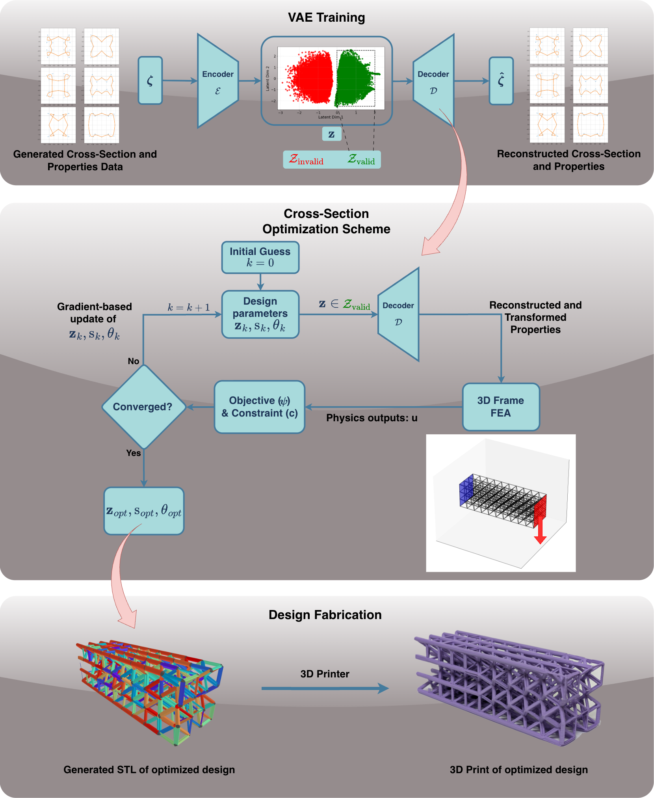

# LatticeCrossSectionOptExplicit

Gradient-based design of 3D-printed lattice structures, from the strut cross-section to the impact response.

- **Cross-section design:** free-form beam sections from a variational autoencoder (VAE), optimised in its latent
  space.
- **Impact simulation:** a differentiable explicit dynamics solver for lattices of beams, with large rotation,
  visco-hyperelastic material (EPU 45), contact and friction.
- **Exact gradients:** through thousands of time steps, from a memory-efficient discrete adjoint.
- **Printable joints:** smooth, watertight node joints (FHS) for any radii and any section shape, exported to STL / 3MF.
- **Validation:** against Abaqus/Explicit, from single struts to solid unit cells.

The linear-elastic VAE section optimisation (the earlier paper) is described in [`readME_old.md`](readME_old.md):
> A. Kumar, S. Sridhara, K. Suresh, *Optimizing the Cross-Sections of Lattice Structures Using Variational
> Autoencoders*, [SSRN 6128827](https://ssrn.com/abstract=6128827). University of Wisconsin-Madison.



---

## What is in here

| part | what it does | main code |
|---|---|---|
| **VAE cross-sections** | B-spline sections; a VAE trained on valid and invalid shapes gives a smooth, low-dimensional design space; the decoder is differentiable | `trainVAE.py`, `src/vaeNet.py`, `src/splineGeom.py`, `src/sectionModel.py`, `src/geomProp.py` |
| **Linear frame optimisation** | 3D frame FE with a differentiable sparse solve (adjoint), optimisation in the latent space, STL output | `optBeam.ipynb`, `src/frameFE3.py`, `src/optimizeFrame3.py`, `src/linearSolve.py` |
| **Explicit impact solver** | co-rotational 3D Timoshenko beams, lumped mass, central-difference (velocity Verlet) time stepping with an adaptive stable time step (power iteration), smooth penalty contact (beam-beam, beam-plate) with Coulomb friction | `src/explicitFE.py`, `src/explicitSolve.py`, `src/contact.py` |
| **Material** | EPU 45 visco-hyperelastic section law (Yeoh + Prony, fibre integration for large-strain bending) | `src/material.py`, `config/materials.yaml`, `ViscoHyperLaw` in `src/explicitFE.py` |
| **Drop / crush rig** | the lattice between plates, hit by an impactor; objectives (force-stroke target, specific energy absorption) | `src/latticeSetup.py`, `src/objectives.py` |
| **Gradients** | exact discrete adjoint of the explicit scheme with √N checkpointing (memory flat in time; equal to unrolled AD to 1e-16), wrapped as a `torch.autograd.Function` | `src/adjoint.py`, `src/optimizeDrop.py`, `src/dropGrad.py` |
| **Joint stiffness in the beam model** | fused-section joint stiffening taken from the printed joint shape (no fitted constant) | `src/jointSection.py` |
| **Joint stiffness: closed-form, differentiable rule** | stiffening of the beam ends from the strut angles and radii at each node (rigid-like zone of ~0.8 x the geometric length, saturating valence sum), exact design gradients (adjoint = AD = finite differences), fitted and cross-validated against 22 Abaqus solid specimens; presets for design use | `src/jointRule.py` (`PRESETS`), fits in `abaqus/results/rule_fit*`, scripts `abaqus/fit_rule2.py`, `abaqus/wrapup_table.py` |
| **Print joints (FHS)** | Faired Hull-Subdivision node joints: hull of the strut rings, Loop subdivision, thin-plate fairing kept outside the strut cores; graded radii and non-circular (incl. VAE) sections; whole-lattice watertight STL / 3MF | `src/nodeJoint.py` (`lattice_fhs`) |
| **Other joint methods (for comparison)** | rolling-ball fillets (SDF), soap-film method (port of Luo & Zou 2025), Savio et al. 2018 | `src/smoothJoint.py`, `src/subdivLattice.py`, `src/soapFilm.py` |
| **Abaqus/Explicit benchmarks** | input files for every validation case (beams, crossings, lattices, solid unit cells, single EPU 45 struts), our matching runs, comparison and figures | `abaqus/` (see [`abaqus/README.md`](abaqus/README.md), [`abaqus/BENCHMARK_PLAN.md`](abaqus/BENCHMARK_PLAN.md)) |

## Install

Python 3.12. CPU works; a CUDA GPU speeds up the explicit runs and gradients.

```bash
pip install -r requirements-explicit.txt      # torch, numpy, scipy, trimesh, manifold3d, shapely, scikit-fem, pyamg, ...
pip install gmsh                              # optional: solid tet meshes for the Abaqus solid benchmarks
```

Trained VAE checkpoints are in `savedNet/` (e.g. `splineNet50k_n_cp_5_2x512nfeatures_14.pth`).

## Quick start

All scripts run from the repository root with `PYTHONPATH=src:tests`.

```bash
# tests (explicit solver, contact, material law, adjoint vs unrolled AD / finite differences, joints)
PYTHONPATH=src:tests python -m pytest -q tests

# gradient benchmark: unrolled AD vs checkpointed adjoint (memory and time)
PYTHONPATH=src:tests python tests/study_adjoint_benchmark.py adjoint cuda 1.0 8e-3

# printable FHS joints for a lattice -> STL
PYTHONPATH=src:tests python tests/make_joint_check_stl.py

# Abaqus benchmark case: write the .inp, run ours, compare once the Abaqus CSV exists
PYTHONPATH=src:tests python abaqus/cases.py B1a
PYTHONPATH=src:tests python abaqus/compare.py B1a
```

Minimal use of the explicit drop with an exact gradient:

```python
import torch
torch.set_default_dtype(torch.float64)                 # the solver and its gradient checks use float64
from latticeSetup import example3, drop_rig, n_design_rows
from dropGrad import nominal, radii, placeholder_J
from adjoint import DropStepper, checkpointed_adjoint
from material import epu45

lat = example3(elemSize=1.0)                            # 3 x 3 C4 lattice, 1 mm beam elements
x0 = torch.full((n_design_rows('Midplane', lat), 1), 0.8)
rig_kw = dict(law={'kind': 'crit_damped', 'F_ref': 2000.0, 'delta_ref': 0.2}, start='co_moving', gap0=0.1, energy_J=0.75)
rig0, schedule = nominal(lat, x0, 'Midplane', epu45(), T=8e-3, **rig_kw)       # the simulation (adaptive dt)
x = x0.clone().requires_grad_(True)
rig = drop_rig(lat, radii(x, 'Midplane', lat), rig0['law'], mat=epu45(), freeze=rig0,
               **{k: v for k, v in rig_kw.items() if k != 'law'})
J, (dJdx,) = checkpointed_adjoint(DropStepper(rig, schedule, placeholder_J), [x])
```

## Joint stiffness in the beam model

A beam model of a printed lattice is too soft at the nodes (7-70 % on the unit cells here). `src/jointRule.py` adds a closed-form, differentiable stiffening of the strut ends, a function of the
radii and angles of the struts meeting at each node, fitted and cross-validated against Abaqus solid models of the FHS print geometry:

```python
import jointRule
rig = drop_rig(lat, radii, law, mat=mat, joint=jointRule.PRESETS['R5'], ...)     # same call for the explicit solver and the adjoint
```

- accuracy on 22 prescribed-motion specimens: 5 % rms held out for long-strut cells (simple cubic, BCC, octet, C12, unequal-radius T-joints, within +-6 %); **the C4 design cell is 16-24 % too soft** (its short struts), see `abaqus/BENCHMARK_PLAN.md` and
  `abaqus/results/joint_model_summary.md`;
- the design gradient through the joint model is exact (`tests/test_joint_rule_adjoint.py`, kink-free `smooth` form, `tests/test_joint_rule_smooth.py`: autograd = finite differences at random radii, parameter gradients exact); the geometry-based slicing model (`jointSection.py`) is accurate but not differentiable.

## Performance (measured)

3 × 3 C4 drop lattice: 1 mm elements (1,332 beams), 8 ms impact (8,017 steps), EPU 45, contact + friction, 36
design variables, GPU RTX 3060 Ti.

| | time |
|---|---|
| simulation | 208 s |
| gradient (forward replay + backward) | 95 s + 316 s |
| peak GPU memory for the gradient | 0.44 GB |

Unrolled reverse AD of the same run would need ~1 TB (it already needs 16.7 GB for 1 ms on a 3 mm mesh).

## Validation against Abaqus/Explicit (summary)

- **Beam-level cases** (cantilever, strut impact and buckling, crossed beams, lattice drops with contact and
  friction): 0.1-3 %.
- **Single EPU 45 strut (B1):**
  - axial, fast and slow, ±30 %: 0.5-2.1 %;
  - bending: 5-9 % softer.
- **Solid unit cells with FHS joints:**
  - linear: within ±5 % in stroke;
  - EPU 45: C4 cells 0.1-5 %, BCC / C12 6.5-12.5 % too stiff. Traced to the joint model with the viscoelastic
    material; work in progress.

Per-case reports: `abaqus/results/`; plan and status: `abaqus/BENCHMARK_PLAN.md`.

## Repository layout

```
src/            solvers, material, contact, adjoint, joints, VAE / section code
tests/          pytest suite + study scripts (benchmarks, joint studies, sweeps)
abaqus/         Abaqus input generator (cases.py), extraction, comparison, results, inputs (inp/)
config/         material data (materials.yaml)
savedNet/       trained VAE checkpoints
optBeam.ipynb   linear lattice optimisation with VAE sections (earlier paper)
trainVAE.py     VAE data generation and training
ResultsFig/, STL/, Images/, PaperImg/   figures and geometry outputs
```

## License

GNU Affero General Public License v3.0 (AGPL-3.0); see [`LICENSE`](LICENSE).

## Citation

If you use this code, please cite the VAE cross-section paper above. The explicit impact solver, the adjoint and the
FHS joints are part of ongoing work by the same authors.
